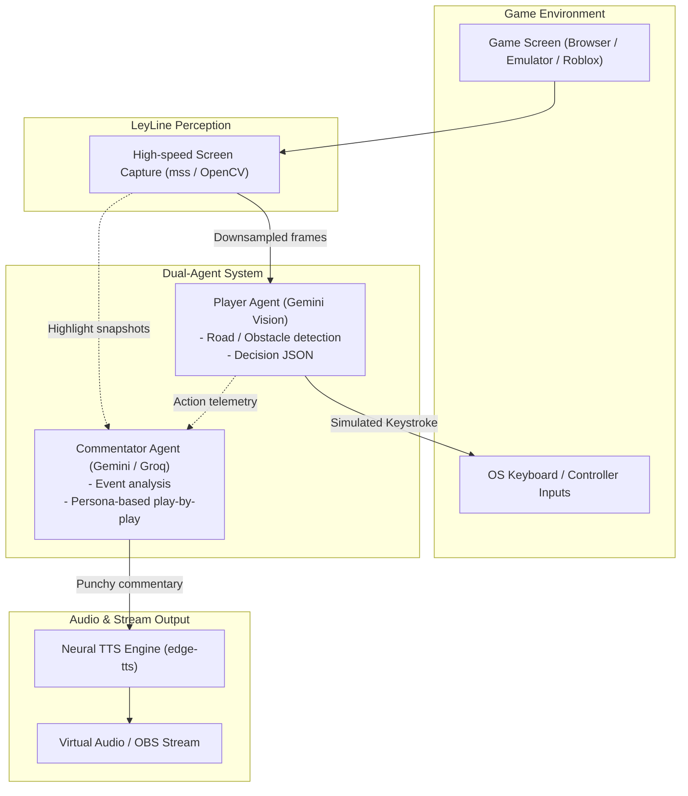

# LeyLine-Engine

[](https://github.com/UpsiDupsii/LeyLine-Engine/actions/workflows/ci.yml)
[](LICENSE)
[](https://www.python.org/downloads/)

LeyLine is an autonomous dual-agent AI gaming platform designed to play video games (Roblox, Subway Surfers, NES classics like Contra and Adventure Island) while running a dynamic, real-time AI live commentator powered by Google Gemini. Built with live streaming in mind (YouTube Live / OBS).

---

## Key Features

- AI Gamer Agent: Real-time perception and gameplay decision engine powered by Gemini multimodal vision models.
- AI Shoutcaster Agent: Asynchronous, witty esports commentator that reacts dynamically to game highlights and clutch plays.
- Non-Blocking Architecture: Decoupled vision-action loop and commentary synthesis ensures zero steering lag.
- Realistic Neural TTS: Natural esports voice output powered by edge-tts.
- Stream-Ready: Designed to output video and audio layers directly compatible with OBS Studio for YouTube Live streams.

---

## Architecture



---

## Quickstart

### 1. Prerequisites
- Python 3.10 or higher
- A Google Gemini API Key (Google AI Studio: https://aistudio.google.com/)

### 2. Installation

Clone the repository and install dependencies:

```bash
git clone https://github.com/UpsiDupsii/LeyLine-Engine.git
cd LeyLine-Engine
python -m venv .venv
# Windows:
.venv\Scripts\activate
# Linux/macOS:
# source .venv/bin/activate

pip install -e ".[dev]"
```

### 3. Configure Environment

Copy `.env.example` to `.env` and insert your Gemini API Key:

```bash
cp .env.example .env
```

Edit `.env`:
```env
GEMINI_API_KEY=your_gemini_api_key_here
```

---

## Development & CI

This repository uses Ruff for linting and code formatting.

```bash
# Check linting
python -m ruff check .

# Check formatting
python -m ruff format --check .

# Auto-fix formatting
python -m ruff format .
```

---

## Roadmap

- [x] Initial project scaffolding & CI setup with Ruff
- [ ] Screen region capture & visual calibration tool
- [ ] Keyboard input controller (pynput)
- [ ] Gemini multimodal gamer agent (perception -> action loop)
- [ ] Commentator agent with edge-tts live voice streaming
- [ ] OBS virtual camera & audio routing for YouTube Live
- [ ] Game-specific presets (Subway Surfers, Contra, Adventure Island, Roblox)

---

## License

MIT License. See [LICENSE](LICENSE) for details.
