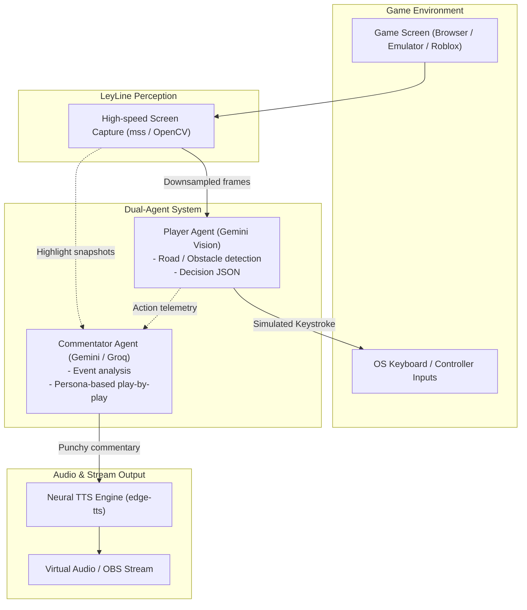

# LeyLine-Engine

[](https://github.com/UpsiDupsii/LeyLine-Engine/actions/workflows/ci.yml)
[](LICENSE)
[](https://www.python.org/downloads/)

LeyLine is an autonomous dual-agent AI gaming platform designed to play video games (Roblox, Subway Surfers, NES classics like Contra and Adventure Island) while running a dynamic, real-time AI live commentator powered by Google Gemini. Built with live streaming in mind (YouTube Live / OBS).

---

## Key Features

- AI Gamer Agent: Real-time visual perception and tactical action planner powered by multimodal Gemini.
- Controller Simulation: Low-latency virtual keyboard inputs using pynput with arrow and WASD layouts.
- Live Telemetry HUD: Real-time OpenCV window rendering captured game frames, AI decision overlays, latency metrics, and tactical reasoning.
- Screen Perception Engine: Sub-millisecond screen frame grabber and interactive ROI calibrator using mss and OpenCV.
- Non-Blocking Architecture: Decoupled vision-action loop and commentary synthesis ensures zero steering lag.
- Realistic Neural TTS: Natural esports voice output powered by edge-tts.
- Stream-Ready: Designed to output video and audio layers directly compatible with OBS Studio for YouTube Live streams.

---

## Architecture



---

## Quickstart

### 1. Prerequisites
- Python 3.10 or higher
- A Google Gemini API Key (Google AI Studio: https://aistudio.google.com/)

### 2. Installation

Clone the repository and install dependencies:

```bash
git clone https://github.com/UpsiDupsii/LeyLine-Engine.git
cd LeyLine-Engine
python -m venv .venv
# Windows:
.venv\Scripts\activate
# Linux/macOS:
# source .venv/bin/activate

pip install -e ".[dev]"
```

### 3. Configure Environment

Copy `.env.example` to `.env` and insert your Gemini API Key:

```bash
cp .env.example .env
```

Edit `.env`:
```env
GEMINI_API_KEY=your_gemini_api_key_here
GROQ_API_KEY=your_groq_api_key_here
```

---

## Screen Perception & Calibration

LeyLine includes an interactive tool to calibrate the screen bounding box around any game window so the vision engine processes only the relevant gameplay area.

### 1. Detect System Monitors
```bash
python -m leyline.vision --monitors
```

### 2. Interactive Region Calibration
Launch the calibrator to select the game window on your screen:
```bash
# Calibrate for a specific game preset (e.g. car_game, roblox, subway_surfers)
python -m leyline.vision --calibrate --preset car_game
```
Instructions:
- A full-screen snapshot will appear.
- Click and drag a rectangle over the game canvas.
- Press `ENTER` or `SPACE` to confirm and save the preset.
- Press `c` to cancel.

### 3. Live Stream Preview
Verify frame alignment and capture performance in real time:
```bash
python -m leyline.vision --preview --preset car_game --fps 15.0
```
Press `q` or `ESC` in the preview window to exit.

---

## Autonomous Gameplay Runner (Live HUD)

Run the autonomous AI player against your calibrated game window:

```bash
# 1. Safe dry-run mode (AI decides and shows live HUD, but presses no keys)
python -m leyline.runner --preset car_game --dry-run

# 2. Live autonomous play with arrow key simulation
python -m leyline.runner --preset car_game --fps 2.0

# 3. Live autonomous play with WASD key mapping
python -m leyline.runner --preset roblox --layout wasd --fps 2.0

# 4. Offline mock mode (synthetic frames for testing without API keys)
python -m leyline.runner --mock
```

Press `q` or `ESC` inside the HUD window to immediately exit and safely release all virtual keys.

---

## Development & CI

This repository uses Ruff for linting and code formatting, and pytest for unit testing.

```bash
# Check linting
python -m ruff check .

# Check formatting
python -m ruff format --check .

# Auto-fix formatting
python -m ruff format .

# Run test suite
python -m pytest tests/
```

---

## Roadmap

- [x] Initial project scaffolding & CI setup with Ruff
- [x] Screen region capture & visual calibration tool
- [x] Low-latency keyboard input controller (pynput)
- [x] Gemini multimodal gamer agent (perception -> action loop)
- [x] Real-time live HUD overlay runner (OpenCV)
- [ ] Commentator agent with edge-tts live voice streaming
- [ ] OBS virtual camera & audio routing for YouTube Live
- [ ] Game-specific presets (Subway Surfers, Contra, Adventure Island, Roblox)

---

## License

MIT License. See [LICENSE](LICENSE) for details.
