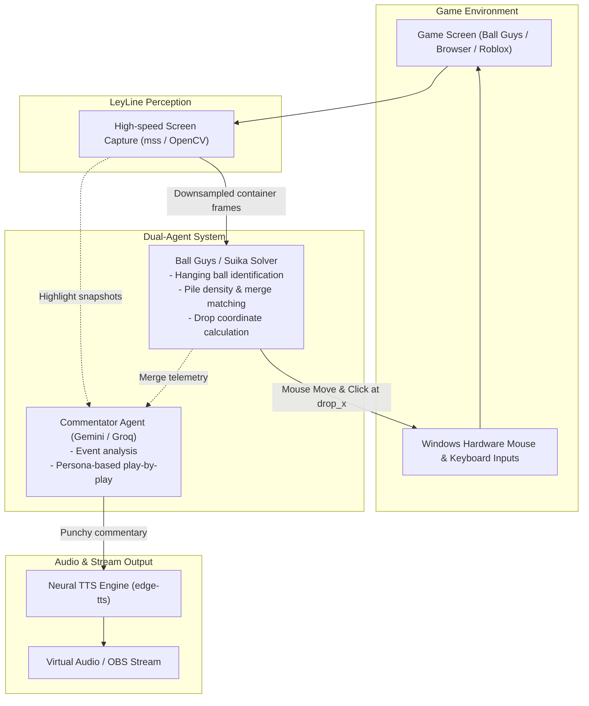

# LeyLine-Engine

[](https://github.com/UpsiDupsii/LeyLine-Engine/actions/workflows/ci.yml)
[](LICENSE)
[](https://www.python.org/downloads/)

LeyLine is an autonomous dual-agent AI gaming platform designed to play video games (Ball Guys / Suika merge puzzles, Roblox, vehicle simulators, Subway Surfers, NES classics) while running a dynamic, real-time AI live commentator powered by Google Gemini. Built with live streaming in mind (YouTube Live / OBS).

---

## Key Features

- Ball Guys / Suika Merge Solver: Physics-aware puzzle solver that analyzes hanging balls and resting container piles, calculates optimal horizontal drop coordinates (`drop_x`), and positions cursor clicks to trigger cascading merges. Features deterministic Computer Vision color/tier matching, valley leveling, and pre-drop alignment verification.
- Autonomous Vehicle & Truck Agent: Tactical driving AI with continuous hardware throttle and obstacle avoidance.
- DirectInput & Hardware Mouse Controllers: Kernel-level mouse positioning, clicks, and keyboard scan codes via Windows SendInput for 100% browser canvas compatibility.
- Real-Time Telemetry HUD: OpenCV display window rendering captured game frames, drop trajectory guide lines, detected container bounds and ball tiers, alignment verification status, latency metrics, and tactical reasoning.
- Screen Perception Engine: Sub-millisecond screen frame grabber and interactive ROI calibrator using mss and OpenCV.
- Non-Blocking Architecture: Decoupled vision-action loop and commentary synthesis ensures zero steering lag.
- Realistic Neural TTS: Natural esports voice output powered by edge-tts.
- Stream-Ready: Designed to output video and audio layers directly compatible with OBS Studio for YouTube Live streams.

---

## Architecture



---

## Quickstart & Environment Setup

### 1. Prerequisites
- Python 3.10 or higher
- A Google Gemini API Key (Google AI Studio: https://aistudio.google.com/)

### 2. Virtual Environment Setup

```bash
# Clone the repository
git clone https://github.com/UpsiDupsii/LeyLine-Engine.git
cd LeyLine-Engine

# Create virtual environment (if not already present)
python -m venv .venv

# Activate in PowerShell (Windows):
.venv\Scripts\Activate.ps1

# Activate in Command Prompt (cmd.exe):
# .venv\Scripts\activate.bat
```

### 3. Install Dependencies

With `.venv` active, install dependencies:

```bash
pip install -r requirements-dev.txt
```

### 4. Configure Secrets

Copy `.env.example` to `.env` and insert your API keys:

```bash
cp .env.example .env
```

Edit `.env`:
```env
GEMINI_API_KEY=your_gemini_api_key_here
GROQ_API_KEY=your_groq_api_key_here
```

---

## Playing "Ball Guys" Merge Puzzle (Step-by-Step)

Ball Guys is a physics drop puzzle (similar to the Watermelon / Suika game). Dropping identical balls together merges them into larger balls (Small Blue -> Medium Purple -> Larger Balls up to King Ball). The goal is to maximize mergers while keeping the pile below the red dashed game-over line.

### Step 1: Open Ball Guys in Your Browser
Open Ball Guys in Chrome or your browser. Position the browser window so the blue container is visible on your screen.

### Step 2: Calibrate the Container Box (Optional if Using Full Window)
Tell LeyLine where the container is located:
```bash
python -m leyline.vision --calibrate --preset ball_guys --delay 4
```
- During the 4-second countdown, switch to your Ball Guys browser window.
- When the screen freezes, click and drag a rectangle around the container (or select your browser window; the built-in Computer Vision detector will automatically find the blue container borders inside the captured region).
- Press `ENTER` to save the preset.

### Step 3: Run the Autonomous Puzzle Solver with Alignment Verification
```bash
python -m leyline.runner --preset ball_guys --agent ball_guys --settle-time 2.2 --hover-delay 0.25 --align-tolerance 10
```
- A 3-second countdown will display: `[3]... [2]... [1]... [GO!]`. Focus on the Ball Guys window.
- The 5-Phase Autonomous Loop:
  1. Perceive: High-speed CV identifies the top active ball, container bounds, red dashed line, and resting balls.
  2. Aim: Moves the mouse cursor to the optimal drop coordinate (matching identical ball colors or leveling valleys).
  3. Hover & Verify Alignment: Waits for the in-game dropper needle to glide to the mouse, captures a fresh verification snapshot, verifies that the needle is centered over the target, and micro-adjusts if off-target.
  4. Release: Clicks the left mouse button to release the ball.
  5. Settle: Waits for balls to drop, roll, bounce, and merge before taking the next turn.
- The HUD window displays live telemetry: cyan container boundaries, green resting ball circles with tier tags (`T1`, `T2`), yellow target drop trajectory, alignment error status, and strategic reasoning.
- Press `q` or `ESC` in the HUD window to stop at any time.

---

## Development & CI

```bash
# Run test suite
python -m pytest tests/

# Check linting
python -m ruff check .

# Check formatting
python -m ruff format --check .

# Auto-fix formatting
python -m ruff format .
```

---

## Roadmap

- [x] Initial project scaffolding & CI setup with Ruff
- [x] Screen region capture & visual calibration tool with countdown delay
- [x] DirectInput hardware scan code keyboard controller (SendInput)
- [x] Hardware mouse controller for click-to-drop puzzle games
- [x] Ball Guys / Suika merge puzzle solver agent
- [x] Autonomous truck / vehicle driver agent with sustained throttle
- [x] Subway Surfers fast reflex lane agent (sub-3ms)
- [x] Real-time live HUD overlay runner with drop line visualizations (OpenCV)
- [ ] Commentator agent with edge-tts live voice streaming
- [ ] OBS virtual camera & audio routing for YouTube Live
- [ ] Game-specific presets (Ball Guys, Truck Simulator, Subway Surfers, Roblox)

---

## License

MIT License. See [LICENSE](LICENSE) for details.
