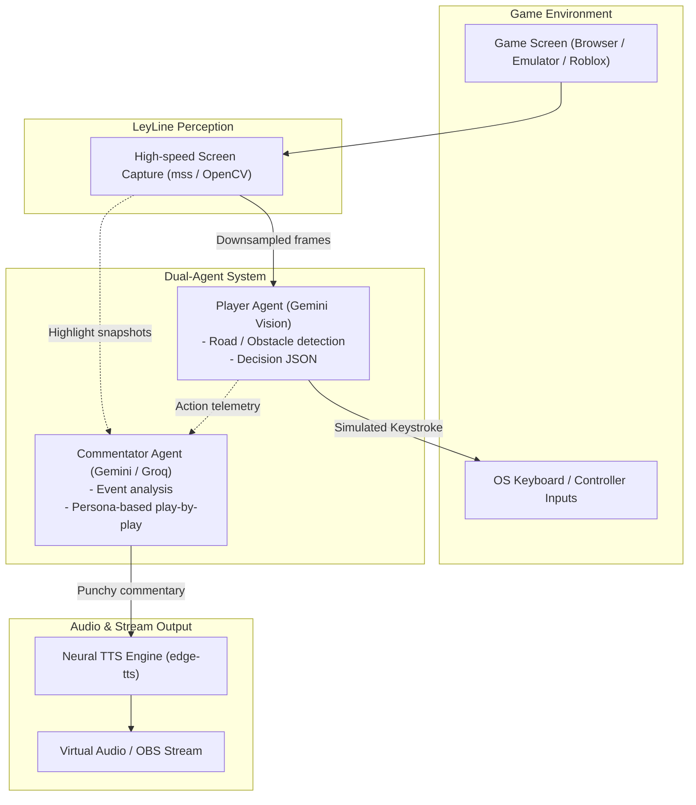

# LeyLine-Engine

[](https://github.com/UpsiDupsii/LeyLine-Engine/actions/workflows/ci.yml)
[](LICENSE)
[](https://www.python.org/downloads/)

LeyLine is an autonomous dual-agent AI gaming platform designed to play video games (Roblox, Subway Surfers, NES classics like Contra and Adventure Island) while running a dynamic, real-time AI live commentator powered by Google Gemini. Built with live streaming in mind (YouTube Live / OBS).

---

## Key Features

- AI Gamer Agent: Real-time visual perception and tactical action planner powered by multimodal Gemini.
- Controller Simulation: Low-latency virtual keyboard inputs using pynput with arrow and WASD layouts.
- Live Telemetry HUD: Real-time OpenCV window rendering captured game frames, AI decision overlays, latency metrics, and tactical reasoning.
- Screen Perception Engine: Sub-millisecond screen frame grabber and interactive ROI calibrator using mss and OpenCV.
- Non-Blocking Architecture: Decoupled vision-action loop and commentary synthesis ensures zero steering lag.
- Realistic Neural TTS: Natural esports voice output powered by edge-tts.
- Stream-Ready: Designed to output video and audio layers directly compatible with OBS Studio for YouTube Live streams.

---

## Architecture



---

## Quickstart & Environment Setup

### 1. Prerequisites
- Python 3.10 or higher
- A Google Gemini API Key (Google AI Studio: https://aistudio.google.com/)

### 2. Virtual Environment Creation & Activation

Always activate the project virtual environment before running commands:

```bash
# Clone the repository
git clone https://github.com/UpsiDupsii/LeyLine-Engine.git
cd LeyLine-Engine

# Create the dedicated virtual environment (if not already created)
python -m venv .venv

# Activate in PowerShell (Windows):
.venv\Scripts\Activate.ps1

# Activate in Command Prompt (cmd.exe):
# .venv\Scripts\activate.bat

# Activate in Linux/macOS:
# source .venv/bin/activate
```

### 3. Install Dependencies

With `.venv` active, install the project requirements:

```bash
pip install -r requirements-dev.txt
```

### 4. Configure Secrets

Copy `.env.example` to `.env` and insert your API keys:

```bash
cp .env.example .env
```

Edit `.env`:
```env
GEMINI_API_KEY=your_gemini_api_key_here
GROQ_API_KEY=your_groq_api_key_here
```

---

## How to Play Any Game Live (Step-by-Step)

### Step 1: Open Your Target Game
Open any browser car game, Subway Surfers, or Roblox in your browser or desktop window. Position it so it is visible on your screen.

### Step 2: Calibrate the Screen Region
Tell LeyLine where your game window is located on screen:
```bash
python -m leyline.vision --calibrate --preset car_game
```
- A full-screen screenshot will appear.
- Click and drag a rectangle around the game canvas (the road or playing field).
- Press `ENTER` or `SPACE` to confirm and save the preset.

### Step 3: Run the AI Gamer (Safe Dry-Run Mode)
Verify the AI's vision and thinking on your live game without it pressing any keys:
```bash
python -m leyline.runner --preset car_game --dry-run
```
- An OpenCV HUD window will pop up showing your real game feed.
- The top banner displays the AI's live decisions (`ACTION: [LEFT]`, `[RIGHT]`, `[SPACE]`), inference latency, and tactical reasoning.

### Step 4: Run Live Autonomous Play
Let the AI actively take control of the keyboard:
```bash
# For games using Arrow keys:
python -m leyline.runner --preset car_game --fps 2.0

# For games using WASD keys:
python -m leyline.runner --preset roblox --layout wasd --fps 2.0
```
- Focus on your game window.
- Press `q` or `ESC` in the LeyLine HUD window at any time to safely stop and release all virtual keys.

### Step 5: Offline Testing (Mock Mode)
To test the HUD without an active game or API call:
```bash
python -m leyline.runner --mock
```

---

## Development & CI

This repository uses Ruff for linting and code formatting, and pytest for unit testing.

```bash
# Check linting
python -m ruff check .

# Check formatting
python -m ruff format --check .

# Auto-fix formatting
python -m ruff format .

# Run test suite
python -m pytest tests/
```

---

## Roadmap

- [x] Initial project scaffolding & CI setup with Ruff
- [x] Screen region capture & visual calibration tool
- [x] Low-latency keyboard input controller (pynput)
- [x] Gemini multimodal gamer agent (perception -> action loop)
- [x] Real-time live HUD overlay runner (OpenCV)
- [ ] Commentator agent with edge-tts live voice streaming
- [ ] OBS virtual camera & audio routing for YouTube Live
- [ ] Game-specific presets (Subway Surfers, Contra, Adventure Island, Roblox)

---

## License

MIT License. See [LICENSE](LICENSE) for details.
